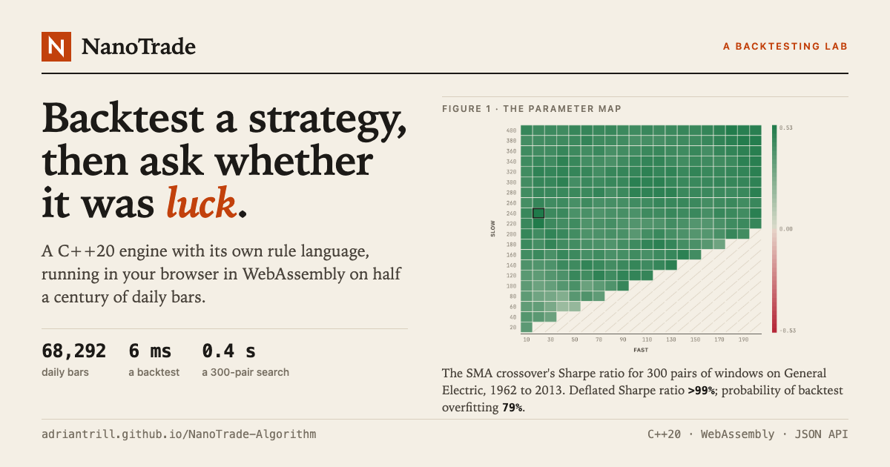
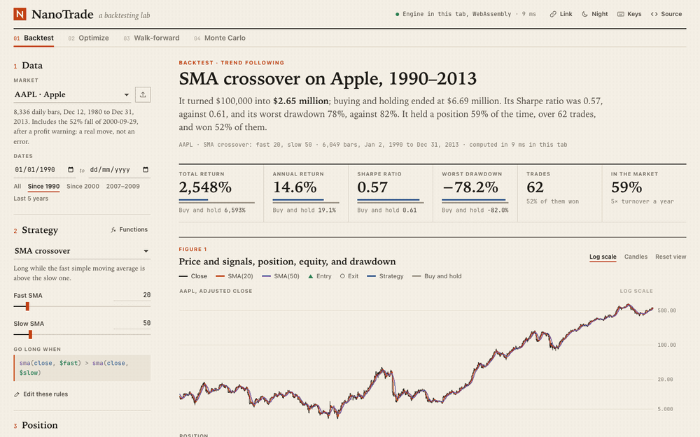
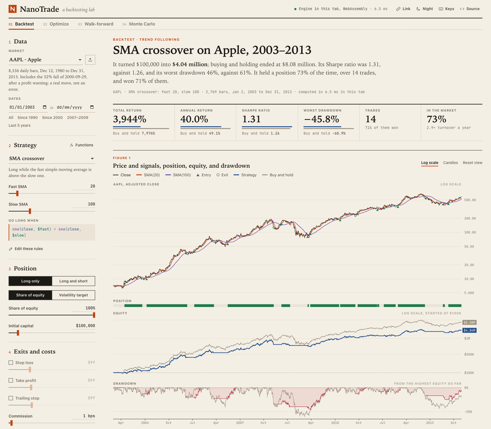
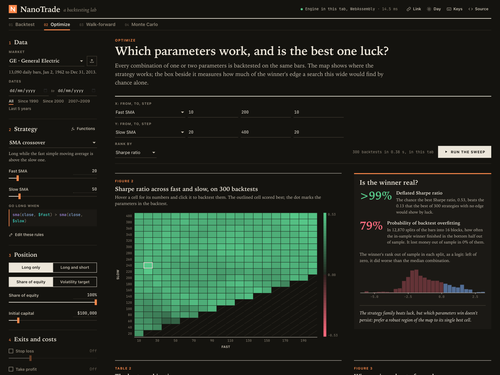
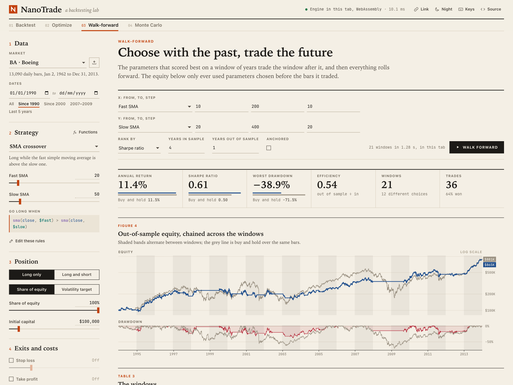
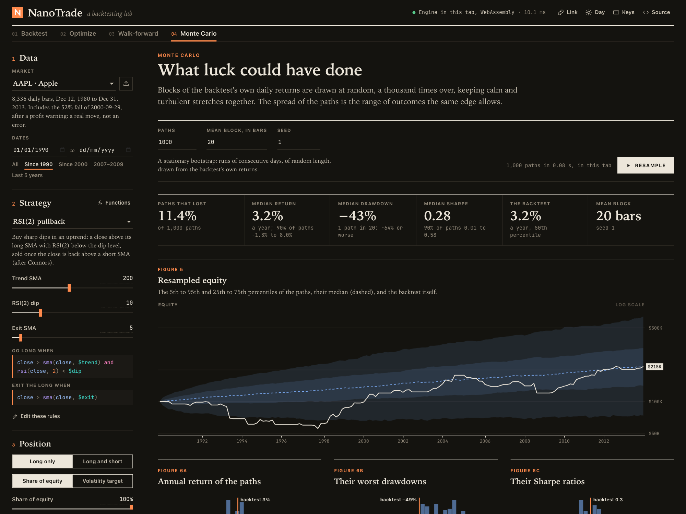
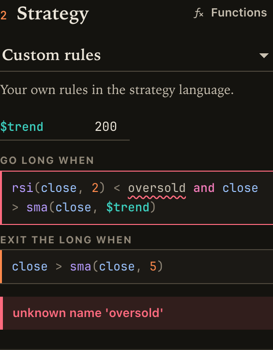
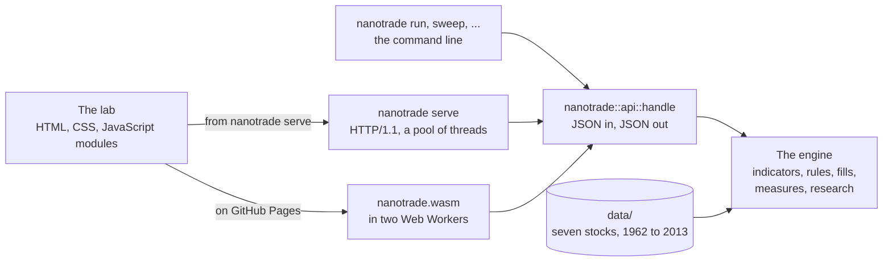

<p align="center">
  <a href="https://adriantrill.github.io/NanoTrade-Algorithm/"></a>
</p>

<p align="center">
  <a href="https://github.com/AdrianTrill/NanoTrade-Algorithm/actions/workflows/ci.yml"></a>
  <a href="https://adriantrill.github.io/NanoTrade-Algorithm/"></a>
  
  
  
  
  <a href="LICENSE"></a>
</p>

NanoTrade is a backtesting engine for trading strategies, in C++20 with no dependencies, and a lab that runs it in your browser. A strategy is a set of rules in a small language, such as `close > sma(close, 200) and rsi(close, 2) < 10`, read at each close and traded at the next open. Then NanoTrade asks the question a backtest usually skips: is the result real? It searches parameters on every core and measures how much of the winner's edge luck explains, with the deflated Sharpe ratio and the probability of backtest overfitting; it tests walk-forward; and it resamples the returns to show what luck could have done. One engine answers one JSON API three ways: from the command line, from its own HTTP server, and compiled to WebAssembly, where the [live lab](https://adriantrill.github.io/NanoTrade-Algorithm/) runs it on 52 years of bundled daily bars with no server at all. The same request gives the same bytes from all three.

> [!NOTE]
> NanoTrade is for research and learning, not investment advice. A backtest describes the past, and the lab is built to show how little of it a search can carry forward.

<p align="center">
  <a href="https://adriantrill.github.io/NanoTrade-Algorithm/"></a>
</p>
<p align="center"><em>The <a href="https://adriantrill.github.io/NanoTrade-Algorithm/">live lab</a> on GitHub Pages: another market, a rule typed by hand, a parameter search and its verdict, a walk-forward test, resampling, and the night edition.</em></p>

## What's inside

| Part | What it does | How it is checked |
| --- | --- | --- |
| **[Engine](#how-a-backtest-runs)** | Fills at the next open with slippage and commissions, stops within the bar, trailing stops, volatility targeting, shorts that pay to borrow, and more than thirty measures of the result | Cases worked by hand, and four properties under random signals on all 68,292 bundled bars |
| **[Rule language](#the-rule-language)** | Strategies as rules: twenty functions, type checks before anything runs, and errors that point at the characters at fault | Every built-in strategy, bar by bar, against an independent version of it |
| **[Is it real?](#is-it-real)** | Parameter sweeps on every core, the deflated Sharpe ratio, the probability of backtest overfitting, walk-forward tests, and Monte Carlo resampling | Known answers: a PBO near one half on pure noise, sweeps equal to separate backtests, and the same bits on one thread or eight |
| **[The lab](#the-lab)** | A research report in the browser: a written verdict, numbered figures, the parameter map, and every run in its link | Headless Chrome on every push, against WebAssembly and against the native server |
| **[One API, three runtimes](#one-engine-three-runtimes)** | The same JSON API from the command line, a native HTTP server, and WebAssembly | 23 golden responses, byte for byte, with GCC, Clang, Apple Clang, MSVC, and in WebAssembly |
| **[What it finds](#what-it-finds)** | A study: eight strategies against buying and holding, what a search finds on random markets, and walk-forward results | CI runs it again and requires every number |
| **[Data](#data)** | 52 years of daily bars for seven US stocks, in the public domain | CI downloads them again and requires the same bytes |

**Contents:** [Try it](#try-it) · [The lab](#the-lab) · [What it finds](#what-it-finds) · [Rule language](#the-rule-language) · [Strategies](#strategies) · [A backtest](#how-a-backtest-runs) · [C++](#use-it-from-c) · [Is it real?](#is-it-real) · [Three runtimes](#one-engine-three-runtimes) · [Performance](#performance) · [Command line](#command-line) · [API](#one-json-api) · [Server](#the-server) · [Data](#data) · [Layout](#repository-layout) · [Build](#build-and-run) · [Tests and CI](#tests-and-ci) · [Credits](#credits)

## Try it

**[Open the lab](https://adriantrill.github.io/NanoTrade-Algorithm/).** It opens on a backtest of the SMA crossover on Apple. Pick a market, or step through them with <kbd>[</kbd> and <kbd>]</kbd>; choose a strategy and drag its parameters, or press <kbd>E</kbd> to edit its rules. <kbd>2</kbd>, <kbd>3</kbd>, and <kbd>4</kbd> open the research views and <kbd>Enter</kbd> runs them. <kbd>S</kbd> copies a link to exactly what you see, <kbd>T</kbd> switches between the paper and night editions, and <kbd>?</kbd> lists every key. The engine runs in your tab, in WebAssembly, so nothing you do leaves the page, including a CSV of your own (<kbd>O</kbd>).

To run it natively:

```bash
cmake -S . -B build -DCMAKE_BUILD_TYPE=Release
cmake --build build --parallel
./build/nanotrade serve        # the lab at http://127.0.0.1:8080, on the native engine
```

## The lab

<p align="center">
  
</p>

The lab reads like a research report rather than a dashboard. Each run gets a headline, a sentence that sets the result against buying and holding, and a dateline with the parameters and the time the engine took. Figures are numbered and drawn on canvas, with their tables beneath them.

- **Backtest.** Six figures against buying and holding, and one chart in four panes on a shared time axis: the price with the strategy's indicators and trades, the position held, equity on a log scale, and drawdowns. It zooms and pans, and shows candles when zoomed in. Below it are the monthly returns, every measure, the worst drawdowns, and the trades.
- **Optimize.** The parameter map colors each combination by its score, on a scale that diverges at zero; hover a cell for its numbers, or click it to backtest it. Beside it, *Is the winner real?* gives the deflated Sharpe ratio, the probability of backtest overfitting, the distribution of the winner's rank out of sample, and a verdict in words.
- **Walk-forward** chains the out-of-sample years into one equity curve, shaded window by window, and lists each window's choice.
- **Monte Carlo** draws the bands of a thousand resampled paths around the backtest, and the distributions of their returns, drawdowns, and Sharpe ratios.
- **A link holds the run.** The address keeps the market, dates, strategy, rules, parameters, costs, and research settings, so a link reopens the same run.

<p align="center">
  
</p>

<p align="center">
   
</p>

## What it finds

[`tools/study.py`](tools/study.py) runs three experiments through the JSON API and writes the tables below, and [`docs/study.json`](docs/study.json) with every number behind them. CI runs it again on every push and fails if a single number would change. Every backtest is long only, over each stock's whole history, and pays 1 basis point of commission and 2 of slippage on every fill.

**Against buying and holding.** Each built-in strategy with its default parameters, on each of the seven stocks; medians over the seven:

<!-- study:strategies -->
| Strategy | Sharpe ratio | Annual return | Worst drawdown | Time in the market | Sharpe ratio above holding's | Shallower drawdown |
| --- | ---: | ---: | ---: | ---: | ---: | ---: |
| SMA crossover | 0.35 | 6.2% | 77% | 56% | 3 of 7 | 6 of 7 |
| EMA crossover | 0.50 | 10.2% | 63% | 57% | 4 of 7 | 7 of 7 |
| MACD | 0.36 | 5.7% | 73% | 50% | 0 of 7 | 6 of 7 |
| Time-series momentum | 0.43 | 6.3% | 69% | 60% | 4 of 7 | 4 of 7 |
| Donchian breakout | 0.39 | 6.2% | 65% | 39% | 1 of 7 | 7 of 7 |
| RSI reversion | 0.28 | 3.6% | 78% | 39% | 1 of 7 | 7 of 7 |
| Bollinger reversion | 0.27 | 3.5% | 63% | 24% | 0 of 7 | 7 of 7 |
| RSI(2) pullback | 0.39 | 3.5% | 39% | 11% | 2 of 7 | 7 of 7 |
| **Buy and hold** | **0.49** | **11.3%** | **86%** | **100%** | | |
<!-- /study:strategies -->

Every strategy spends much of its time out of the market, which is where most of its smaller drawdowns come from, and most earn a lower Sharpe ratio than simply holding the stock. The stocks flatter buying and holding, too: they were chosen knowing they would become large, lasting companies.

**What a search finds.** The SMA crossover has two windows. Searching 300 pairs of them (fast 10 to 200 days, slow 20 to 400, fast below slow) on each stock, and on 20 random markets of 23 years that have nothing to find:

<!-- study:search -->
| Market | Best pair, fast / slow | Its Sharpe ratio | Best by luck alone | Deflated Sharpe ratio | Probability of overfitting | Lost out of sample |
| --- | --- | ---: | ---: | ---: | ---: | ---: |
| AAPL | 10 / 40 | 0.73 | 0.19 | 99.9% | 35% | 3% |
| BA | 20 / 280 | 0.71 | 0.14 | > 99.9% | 61% | 0% |
| CAT | 70 / 100 | 0.49 | 0.22 | 97.5% | 23% | 1% |
| DELL | 150 / 280 | 0.73 | 0.21 | 99.5% | 85% | 4% |
| EBAY | 10 / 20 | 0.68 | 0.26 | 95.7% | 45% | 12% |
| F | 200 / 360 | 0.53 | 0.27 | 94.6% | 35% | 5% |
| GE | 20 / 240 | 0.53 | 0.13 | 99.8% | 79% | 0% |
| *20 random markets, median* | | 0.16 | 0.29 | 33.4% | 50% | 67% |

The winner's deflated Sharpe ratio reaches 95% on 6 of the 7 stocks and on 0 of the 20 random markets.
<!-- /study:search -->

A search always finds a winner, on random markets too. The deflated Sharpe ratio tells them apart, but it tests against a Sharpe ratio of zero, and a long position in a stock that rose for decades clears that. Whether the *choice* of windows means anything is what the probability of backtest overfitting measures, and on the stocks it is far from zero: the pair that was best on one half of the history often ranks in the bottom half of the other.

**Walk-forward.** The same search on four years at a time, each winner traded on the year after:

<!-- study:walk_forward -->
| Stock | Years traded | Windows | Sharpe ratio in sample | Sharpe ratio out of sample | Buy and hold, same years | Efficiency |
| --- | ---: | ---: | ---: | ---: | ---: | ---: |
| AAPL | 29 | 30 | 1.03 | 0.47 | 0.62 | 0.67 |
| BA | 48 | 48 | 1.03 | 0.45 | 0.46 | 0.48 |
| CAT | 48 | 48 | 0.82 | 0.32 | 0.39 | 0.41 |
| DELL | 21 | 22 | 1.00 | 0.58 | 0.60 | 0.71 |
| EBAY | 11 | 12 | 0.87 | 0.49 | 0.51 | 0.49 |
| F | 38 | 38 | 0.86 | 0.37 | 0.32 | 0.49 |
| GE | 48 | 48 | 0.85 | 0.41 | 0.42 | 0.54 |

Medians: 0.87 in sample, 0.45 out of sample, and 0.46 for buying and holding; the walk-forward beat holding's Sharpe ratio on 1 of the 7 stocks.
<!-- /study:walk_forward -->

The windows that looked best on the past kept about half their Sharpe ratio on the year after, which leaves the crossover close to holding the stock. That is the gap a backtest optimized on its own history hides, and the gap the lab is built to show.

## The rule language



```text
crossover(ema(close, 12), ema(close, 26)) and rsi(close, 14) < 70
close > highest(high, 55)[1]
zscore(close, 20) < -2 and close > sma(close, $trend)
```

A rule combines the prices (`open`, `high`, `low`, `close`, `volume`, `hl2`), numbers, arithmetic, comparisons, `and`, `or`, `not`, and twenty functions: `sma`, `ema`, `rsi`, `stdev`, `highest`, `lowest`, `roc`, `change`, `zscore`, `atr`, `macd`, `macd_signal`, `bb_upper`, `bb_lower`, `crossover`, `crossunder`, `abs`, `min`, `max`, and `log`. `x[n]` is `x` as it was `n` bars ago, and `$name` is a parameter that the lab turns into a field and a search can vary.

Rules are parsed by a Pratt parser and type-checked before they run. An error names the rule and the characters at fault, with a suggestion for a misspelled name: `unknown function 'smaa'; did you mean sma?`. In the lab, the mistake is underlined as you type.

An indicator is undefined until its window is full, and a comparison with an undefined value doesn't hold, so a 200-day average starts trading 200 bars in. Every indicator is computed once per market and shared, so rules over the same `sma(close, 20)` read one array, and so do the 300 backtests of a search.

<br clear="right">

## Strategies

Every built-in strategy is written in the rule language, so a custom one is no different from them.

| Strategy | Goes long when | Exits when |
| --- | --- | --- |
| Buy and hold | always | never |
| SMA crossover | `sma(close, $fast) > sma(close, $slow)` | the entry stops holding |
| EMA crossover | `ema(close, $fast) > ema(close, $slow)` | the entry stops holding |
| MACD | the MACD line is above its signal line | the entry stops holding |
| Time-series momentum | `roc(close, $lookback) > 0` | the entry stops holding |
| Donchian breakout | `close > highest(high, $entry)[1]` | `close < lowest(low, $exit)[1]` |
| RSI reversion | `rsi(close, $period) < $lower` | `rsi(close, $period) > $upper` |
| Bollinger reversion | `close < bb_lower(close, $period, $k)` | `close > sma(close, $period)` |
| RSI(2) pullback | `close > sma(close, $trend) and rsi(close, 2) < $dip` | `close > sma(close, $exit)` |

With shorts allowed, each takes the mirror-image short. Parameters are checked against their ranges, and so are pairs that must be ordered, such as a fast window below a slow one.

## How a backtest runs

1. The rules are evaluated over every bar, giving the position wanted at each close: long, short, or flat.
2. A change of position is ordered at that close and filled at the next bar's open, moved against the trade by the slippage, and charged the commission.
3. Within each bar, stops are checked against its range. An open beyond a stop fills at the open; a bar that reached both the stop and the take profit is assumed to have reached the stop first. After a stop, the strategy has to change its mind before it can enter the same way again.
4. Equity is marked at every close. Shorts pay their borrowing cost each bar, an account that reaches zero stops trading, and a position still open at the end is closed at the last close.

An order is sized at the close so that its shares, slippage, and commission come to the position wanted, and a reversal also pays to close the old side out of the same equity. If the next open gaps so far that the order no longer fits under the leverage cap, it is trimmed, and counted.

The measures include the CAGR from the calendar, volatility, the Sharpe and Sortino ratios, the probabilistic Sharpe ratio, the worst and longest drawdowns, the Calmar ratio, exposure and turnover, the win rate, profit factor, and average win and loss, each trade's maximum adverse and favorable excursions, skew and kurtosis, value at risk and expected shortfall, beta, alpha, and correlation against buying and holding, and every cost paid.

## Use it from C++

```cpp
#include "nanotrade/engine.hpp"
#include "nanotrade/metrics.hpp"
#include "nanotrade/strategy.hpp"

const nanotrade::BarSeries bars = nanotrade::load_csv_file("data/AAPL.csv", "AAPL").series;
nanotrade::indicators::Cache cache(bars);

nanotrade::StrategySpec strategy;
strategy.id = "custom";
strategy.params = {{"trend", 200}, {"dip", 10}};
strategy.rules.long_entry = "close > sma(close, $trend) and rsi(close, 2) < $dip";
strategy.rules.long_exit = "close > sma(close, 5)";

nanotrade::BacktestConfig config;
config.commission_bps = 1;
config.slippage_bps = 2;

const nanotrade::Signals signals = nanotrade::generate_signals(strategy, cache, config.allow_short);
const nanotrade::BacktestResult result = nanotrade::run_backtest(bars, signals.direction, config, 0, bars.size());
const nanotrade::Metrics metrics = nanotrade::compute_metrics(bars, result, {}, config.risk_free_rate);
```

## Is it real?

A backtest that looks good is the easy part. The research tools ask whether it would have held up.

- **Parameter sweeps** try every combination of one or two parameters on every core, sharing the indicators between trials, and rank them by the Sharpe ratio, Sortino ratio, CAGR, total return, Calmar ratio, drawdown, or profit factor.
- **The deflated Sharpe ratio** (Bailey and López de Prado, 2014) is the probability that the winner's true Sharpe ratio beats the best one that luck alone would give among that many trials, given how widely the trials' Sharpe ratios spread, and the skew and fat tails of the winner's returns.
- **The probability of backtest overfitting** (Bailey, Borwein, López de Prado, and Zhu, 2017) cuts the history into 16 blocks, or fewer for the widest searches. For every way to pick half of them (12,870 for 16), it finds the best trial on that half and ranks it on the other. PBO is how often the winner lands in the bottom half out of sample.
- **Walk-forward testing** optimizes on a window of years, trades the year after, and rolls forward, or keeps the start anchored. The out-of-sample years are stitched into one equity curve, and the efficiency is their mean annual return over the in-sample one.
- **Monte Carlo resampling** draws a thousand alternative histories from the strategy's own daily returns by a stationary bootstrap (Politis and Romano, 1994), whose random-length blocks keep volatility clusters together. It reports bands of equity over time and the spread of the return, drawdown, and Sharpe ratio, with the chance of ending below the starting capital.
- **Random markets** are the control: `synthesize()` makes daily bars with GARCH(1,1) volatility clustering and jumps, and no structure a strategy could exploit, so whatever a search finds on one is luck. A seed gives the same market on every platform.

Continuing the example above, a search of 400 pairs of windows:

```cpp
#include "nanotrade/research.hpp"

nanotrade::SweepSpec sweep;
sweep.x = {"fast", 10, 200, 10};
sweep.y = nanotrade::SweepAxis{"slow", 20, 400, 20};

nanotrade::StrategySpec crossover;
crossover.id = "sma_cross";

const nanotrade::SweepResult search = nanotrade::run_sweep(bars, cache, crossover, config, 0, bars.size(), sweep);
// search.overfit.deflated_sharpe, search.overfit.pbo, and every trial's metrics in search.trials
```

## One engine, three runtimes



The lab never knows which engine it has. It imports its own `runtime.js`, which says WebAssembly on a static site, and which `nanotrade serve` answers itself, saying native. In the browser, the engine runs in two Web Workers: one answers the interactive backtests and the other runs searches, walk-forward tests, and resampling, so dragging a slider never waits behind a long job. The WebAssembly build is 0.49 MB (0.20 MB compressed), with C++ exceptions carried by the browser's native WebAssembly exception handling.

**The same request gives the same bytes everywhere.** The engine computes exp, log, and the normal distribution itself instead of trusting each platform's math library, compiles without floating-point contraction, draws random numbers with its own generator and distributions, and writes each number as the shortest decimal that reads back exactly. [`tests/golden/`](tests/golden) holds 23 requests with their responses, and CI requires every one byte for byte with GCC, Clang, Apple Clang, and MSVC, and in WebAssembly in Node.

## Performance

Measured with `nanotrade bench` on an Apple M4 (four performance and six efficiency cores), on General Electric's 13,090 bars, and with the same requests to the WebAssembly build in V8, the JavaScript engine of Chrome and Node:

| Task | Native | WebAssembly |
| --- | ---: | ---: |
| A backtest, with its measures and buying and holding | 0.80 ms | 0.91 ms |
| The same, with the equity, indicators, and trades the lab draws | 4.7 ms | 7.3 ms |
| A search of 1,600 SMA pairs, on one thread | 0.57 s | 0.61 s |
| The same search on all ten cores | 0.12 s | |
| Monte Carlo resampling, 1,000 paths | 37 ms | 51 ms |

A search shares one set of indicators among all its trials, and its threads take trials from a shared counter, so ten cores run it 4.6 times as fast. Each result goes into its trial's slot, so a search comes out the same on any number of threads. In the browser, a search runs on one thread in its own worker: GitHub Pages can't send the headers that WebAssembly threads need.

## Command line

```bash
nanotrade run --data AAPL --strategy rsi2_pullback --commission 1 --slippage 2
nanotrade run --data F --long "rsi(close, 2) < 10 and close > sma(close, 200)" --long-exit "close > sma(close, 5)"
nanotrade sweep --data GE --x fast=10:200:10 --y slow=20:400:20
nanotrade walkforward --data CAT --strategy rsi_reversion --x period=5:25:5 --is-years 5 --oos-years 2
nanotrade montecarlo --data BA --strategy momentum --paths 2000
nanotrade serve                   # the API and the lab at http://127.0.0.1:8080
```

A sweep ends with its verdict:

```text
GE (General Electric), 1962-01-02 to 2013-12-31, 13,090 bars
Swept fast and slow: 400 combinations, 300 valid, ranked by sharpe
  100 couldn't run, such as: Fast SMA (20) must be less than Slow SMA (20)

Top combinations
  fast     20  slow    240   Sharpe   0.53   CAGR    8.3%   max drawdown   39.1%   trades 39
  fast     20  slow    220   Sharpe   0.53   CAGR    8.1%   max drawdown   43.0%   trades 45
  fast    180  slow    400   Sharpe   0.52   CAGR    8.5%   max drawdown   42.9%   trades 17
  ...

Overfitting
  Deflated Sharpe ratio  99.8%  (the chance the best Sharpe of 0.53 beats the 0.13 that luck alone would give the best of 300 trials)
  Probability of backtest overfitting  80.3%  (12,870 splits of 16 blocks: how often the in-sample winner finished in the bottom half out of sample)
  In-sample winner lost money out of sample  0.2% of splits
```

`nanotrade --help` lists every option: costs, sizing, stops, shorts, date ranges, random markets, CSV files, and `--json` for the raw response.

## One JSON API

The command line, the server, and the browser all send the same JSON requests to one function, `nanotrade::api::handle`, and get the same responses.

| Command | What it does |
| --- | --- |
| `version` | The engine's version |
| `catalog` | The strategies with their parameters, ranges, and rules, and the rule language's functions |
| `datasets` | The bundled datasets, with their date ranges and notes |
| `load` | Adds a CSV file's text as a named dataset |
| `bars` | A dataset's bars over a date range |
| `backtest` | A backtest: its measures against buying and holding, equity and indicator series, trades, monthly and yearly returns, and worst drawdowns |
| `sweep` | Every combination of one or two parameters, the ten best, and the overfitting measures |
| `walkforward` | A walk-forward test, window by window, and its chained equity |
| `montecarlo` | A backtest's returns resampled into bands and distributions |

```json
{"command": "backtest", "data": "AAPL", "range": {"from": "2003-01-01"},
 "strategy": {"id": "custom", "params": {"trend": 200},
              "long_entry": "close > sma(close, $trend) and rsi(close, 2) < 10", "long_exit": "close > sma(close, 5)"},
 "config": {"commission_bps": 1, "slippage_bps": 2, "stop_loss": 0.08}}
```

A request is checked before anything runs. An error names the field at fault, suggests the name that was meant, and points into a rule:

```json
{"ok": false, "error": {"message": "unknown function 'smaa'; did you mean sma?", "field": "strategy.long_entry", "position": 8, "length": 4}}
{"ok": false, "error": {"message": "unknown field config.comission_bps; did you mean commission_bps?", "field": "config.comission_bps"}}
```

**The same request gives the same bytes everywhere.** The engine computes exp, log, and the normal quantile itself instead of trusting each platform's math library, compiles without floating-point contraction, draws random numbers with its own generator and distributions, and writes each number as the shortest decimal that reads back exactly. [`tests/golden/`](tests/golden) holds 23 requests with their responses, and CI requires every one byte for byte with GCC, Clang, Apple Clang, and MSVC.

## The server

`nanotrade serve` answers `POST /api` with the JSON API, `GET /api/health` with the engine's version, and anything else from the lab's files. It is a small HTTP/1.1 server on the operating system's own sockets (POSIX or Winsock) with a pool of threads, so a sweep from the page runs natively on every core. It caps the size of headers and bodies, times out slow clients, answers 503 when its queue is full, and serves files only from inside the site's directory: no `..`, no backslashes or colons, and no symbolic links that lead out.

## Data

[`data/`](data/README.md) holds daily bars of Apple, Boeing, Caterpillar, Dell, eBay, Ford, and General Electric from the Quandl WIKI dataset, which is in the public domain, adjusted for splits and dividends: 68,292 bars from 1962 to 2013. [`tools/prepare_data.py`](tools/prepare_data.py) downloads them at a pinned commit and records each file's SHA-256 in [`data/manifest.json`](data/manifest.json), and CI requires a fresh download to reproduce them byte for byte. [data/README.md](data/README.md) lists what the source gets wrong and what the loader repairs.

The loader reads the CSV files of Yahoo, Stooq, Nasdaq.com, and Quandl: it finds the columns by name, uses adjusted prices when the file has them, reads dates in any common form, sorts files that are newest first, and repairs and reports bars whose high and low don't contain the open and close.

## Repository layout

```text
.
├── .github/workflows/
│   ├── ci.yml                  # four compilers, sanitizers, format, data, and the study
│   └── pages.yml               # WebAssembly build, golden and headless-Chrome checks, deploy
├── include/nanotrade/          # the engine's headers
├── src/
│   ├── indicators.cpp          # indicators, computed once per market and shared
│   ├── expression.cpp          # the rule language: tokens, a Pratt parser, types, evaluation
│   ├── strategy.cpp            # the built-in strategies, as rules
│   ├── engine.cpp              # fills, costs, stops, and sizing
│   ├── metrics.cpp             # the measures, drawdowns, and calendar returns
│   ├── research.cpp            # sweeps, deflated Sharpe, PBO, walk-forward, Monte Carlo
│   ├── synthetic.cpp           # random markets
│   ├── series.cpp              # the CSV loader
│   ├── api.cpp                 # the JSON API
│   ├── http.cpp                # the HTTP server, and a client for tests
│   └── json.cpp, math.cpp, text.cpp, time.cpp
├── tools/
│   ├── nanotrade_main.cpp      # the command line and the server
│   ├── prepare_data.py         # downloads data/ at a pinned commit, or checks it
│   └── study.py                # the README's study
├── tests/
│   ├── *_tests.cpp             # a suite per module
│   └── golden/                 # requests and their exact responses
├── web/
│   ├── index.html, style.css   # the lab
│   ├── js/                     # its modules: views, charts, the engine bridge, workers
│   ├── nanotrade_wasm.cpp      # the WebAssembly entry points
│   ├── check.mjs, ui-check.mjs # the golden responses in WebAssembly, and the lab in Chrome
│   ├── capture.mjs             # this README's images and the link preview
│   └── serve.mjs, social-card.html
├── data/                       # the bars, and manifest.json with their SHA-256s
└── docs/                       # study.json and the README's images
```

## Build and run

Requirements: CMake 3.21+ and a C++20 compiler (GCC 11+, Clang 14+, Apple Clang 15+, or MSVC 2022). The lab's WebAssembly build needs [Emscripten](https://emscripten.org); CI uses 7.0.0.

```bash
cmake -S . -B build -DCMAKE_BUILD_TYPE=Release
cmake --build build --parallel
ctest --test-dir build --output-on-failure
./build/nanotrade serve                          # the lab on the native engine

emcmake cmake -S . -B build-wasm -DCMAKE_BUILD_TYPE=Release
cmake --build build-wasm                         # the static site, in build-wasm/site
node web/serve.mjs build-wasm/site 8000          # served as GitHub Pages serves it
```

## Tests and CI

```bash
ctest --test-dir build --output-on-failure                   # 291 tests in 11 suites, the golden responses, and the command line
npm ci --prefix web
node web/check.mjs build-wasm/site tests/golden               # the golden responses in WebAssembly
node web/ui-check.mjs build-wasm/site                         # the lab in headless Chrome
node web/ui-check.mjs build-wasm/site --native build/nanotrade
python3 tools/study.py build/nanotrade --check                # the README's study
```

| Workflow | Job | What it checks |
| --- | --- | --- |
| CI | Linux GCC, Linux Clang, macOS Apple Clang, Windows MSVC | Builds with warnings as errors, then runs every suite, the golden responses byte for byte, and the command line |
| CI | Sanitizers | Every suite under AddressSanitizer and UndefinedBehaviorSanitizer, and under ThreadSanitizer |
| CI | Format | clang-format on every C++ file |
| CI | Data | Downloads the bars again at the pinned commit; every file must match its SHA-256 |
| CI | Study | Runs the README's study again; every number must match |
| Pages | Browser build | Builds the engine with Emscripten, checks the golden responses in WebAssembly, then drives the lab in headless Chrome, in WebAssembly and against the native server: backtests, sliders, markets, a rule with a mistake and its fix, a search, a walk-forward test, resampling, a CSV, the keys, the editions, a link, a phone's screen, and no console errors or failed requests. Main is then deployed |

[`web/capture.mjs`](web/capture.mjs) regenerates this README's images, the demo, and the link preview from the built site.

## Next steps

- Portfolios: several markets at once, with weights and rebalancing between them, instead of one market at a time.
- Orders beyond the next open: limit and stop entries, and intraday bars to fill them on.
- Data without survivorship bias: a universe that includes the companies that failed.

## Credits

- The data is the Quandl WIKI prices dataset, in the public domain, as published by [MarketData.jl](https://github.com/JuliaQuant/MarketData.jl) (MIT).
- The deflated Sharpe ratio is from Bailey and López de Prado, "The Deflated Sharpe Ratio" (2014); the probability of backtest overfitting from Bailey, Borwein, López de Prado, and Zhu, "The Probability of Backtest Overfitting" (2017); the stationary bootstrap from Politis and Romano (1994); and the RSI(2) pullback after Connors and Alvarez.
- exp and log follow [fdlibm](https://www.netlib.org/fdlibm/); the normal distribution uses Hart's algorithm 5666 as given by West (2005), and Acklam's approximation for its quantile, refined by a Halley step, or beyond 37 standard deviations by Newton's method on the asymptotic series of log Φ.
- Built with [CMake](https://cmake.org) and [Emscripten](https://emscripten.org); the checks drive Chrome with [Puppeteer](https://pptr.dev).

Released under the [MIT License](LICENSE).
